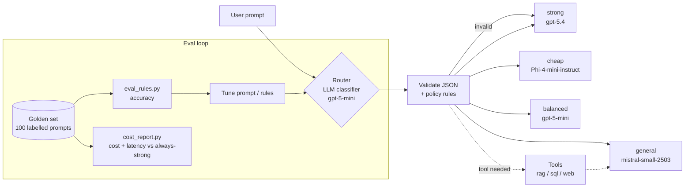

# LLM Auto-Router

**Send every prompt to the cheapest model that can answer it well, and attach a tool (RAG, SQL or web search) when the prompt needs one.**

Built on Azure AI Foundry by [Suhail Ahmed](https://github.com/suhail39ahmed).

---

## Why this matters

Most apps send every request to their biggest, most expensive model, even "translate *thank you* into Japanese". A **model router** looks at each prompt first and picks a model tier:

- Routing **too low** (hard prompt to a small model) costs **quality**: the user gets a wrong answer.
- Routing **too high** (easy prompt to a big model) costs **money**.

This project measures both sides honestly: how often the router picks the right tier, and what that actually saves in dollars and seconds.

---

## Architecture



All four models sit behind **one OpenAI-compatible endpoint** in Azure AI Foundry (`/openai/v1/`). The *deployment name* in each request picks the model, so switching tiers is just changing one string.

| Tier | Model | Used for |
|---|---|---|
| cheap | Phi-4-mini-instruct | greetings, short translations, labels, single facts |
| general | mistral-small-2503 | summaries, rewrites, drafting emails/posts, brainstorming |
| balanced | gpt-5-mini | output that must be exactly right: code, SQL, regex, JSON, debugging |
| strong | gpt-5.4 | design, trade-offs, multi-step reasoning, planning |

---

## How it works

1. **Smoke test** (`scripts/smoke_test.py`): call every deployment once to check it works. All four answered in about 2-3s when warm. Phi's first call took **604s** (a *serverless cold start*: the model was spun down and had to load). Phi also defined "model routing" as network traffic routing, an early warning that small models carry a quality risk.
2. **Golden set** (`eval/golden_prompts.jsonl`): 100 prompts written the way real users phrase things, with no hint words. Each one is labelled with the *cheapest tier that answers correctly*, plus a tool if needed. Mix: 25 cheap, 25 general, 20 balanced, 15 strong, 15 tool (5 rag, 5 sql, 5 web), with 14 deliberately tricky ones.
3. **Rule router** (`src/router/rules.py`): a regex/keyword baseline.
4. **LLM router** (`src/router/llm_router.py`): a small model reads a rubric (the *system prompt*) plus a few worked examples (*few-shot prompting*) and replies in JSON: `{"tier", "tool", "reason"}`.
5. **Deterministic guard rails** around the model:
   - The JSON is validated. Anything invalid falls back to **strong**, the safe choice.
   - Policy rule: answers that use a tool never go to **cheap**, because they need synthesis.
6. **Evaluation** (`src/router/eval_rules.py`) scores tier and tool accuracy against the golden set.
7. **Cost report** (`src/router/cost_report.py`) runs each prompt through its routed model *and* through gpt-5.4, then compares cost and latency. It uses 8 parallel workers and per-call timeouts.

---

## Results

### Routing accuracy (100-prompt golden set)

| Router | Tier accuracy | Tool accuracy |
|---|---|---|
| Rules (regex) | 62% | 94% |
| LLM router (Mistral deciding) | 85% | - |
| + policy rule "tool answers never go to cheap" | 90% | - |
| + few-shot examples, gpt-5-mini as router (`reasoning_effort=minimal`) | **98%** | **97%** |

> Honesty note: some few-shot examples resemble golden prompts, so 98% is optimistic. A held-out test split is the next step.

### Cost and latency vs. sending everything to gpt-5.4

| Run | Scored | Always strong | Routed | Saving |
|---|---|---|---|---|
| 1: Mistral router | 95/100 | $0.5475 / 591s | $0.3889 / 1276s | **29.0% cheaper**, slower |
| 2: gpt-5-mini router, minimal reasoning | 96/100 | $0.5801 / 740s | $0.4244 / 1296s | **26.8% cheaper**, slower |

Unscored prompts timed out. Times are summed per-call latency.

**Prices** (USD per 1M tokens, input/output; Azure Retail Prices API, 2026-10-12):
Phi-4-mini 0.075 / 0.30, gpt-5-mini 0.25 / 2.00, gpt-5.4 2.50 / 15.00.
Mistral-small 0.10 / 0.30 is **estimated** (third-party source, not verified).
Cached-input discounts are not modelled, so the savings are conservative.

---

## Key lessons and challenges

- **Rules plateau quickly.** Users imply intent ("why does this return None?") instead of using keywords, so regex topped out at 62%.
- **LLM classifier + deterministic rules beats either one alone.** Let the model judge, and let code enforce policy and validate output.
- **Cheap is not fast.** Small serverless models were slower per call and had cold starts, while the always-warm Global gpt-5.4 deployment was quick. Optimising for cost and for latency can give different answers.
- **Reasoning tokens are a hidden cost.** Reasoning models bill for "thinking" tokens you never see. `reasoning_effort=minimal` keeps a simple classification cheap.
- **Don't chase 100%.** Tuning until every test passes just memorises the test set.
- **Mistakes aren't equal.** Routing down costs quality and routing up costs money, so when unsure, escalate.

---

## Project structure

```
llm-auto-router/
├── scripts/smoke_test.py        # call every deployment once
├── eval/
│   ├── golden_prompts.jsonl     # 100 labelled prompts
│   └── README_golden.md         # labelling rules
├── src/router/
│   ├── rules.py                 # regex baseline router
│   ├── llm_router.py            # LLM router + validation + policy rules
│   ├── eval_rules.py            # accuracy evaluation
│   └── cost_report.py           # cost/latency vs always-strong
└── .env.example                 # endpoint, key and deployment names
```

## Quickstart

```bash
uv sync
cp .env.example .env          # add your Foundry endpoint, key and deployment names
uv run python scripts/smoke_test.py
uv run python -m src.router.eval_rules        # rule router
uv run python -m src.router.eval_rules llm    # LLM router
uv run python -m src.router.cost_report
```

## Roadmap

- Held-out test split for an honest accuracy number
- Confidence-based escalation (low confidence means bump up a tier)
- Tool execution with LangGraph, using my [production_grade_rag](https://github.com/suhail39ahmed/production_grade_rag) project as the `rag` tool
- Databricks Model Serving routes
- Latency-aware routing (pick by cost *and* speed)

## Related

- RAG project: [github.com/suhail39ahmed/production_grade_rag](https://github.com/suhail39ahmed/production_grade_rag)
